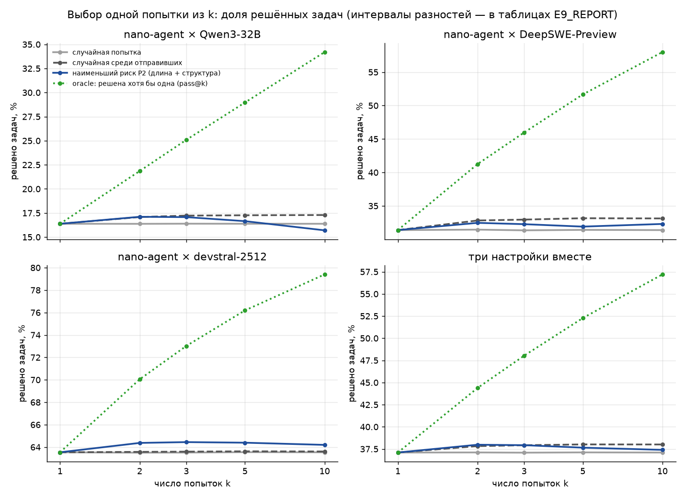

# E9 — выбор лучшей из нескольких попыток по риску модели: результаты

- **Протокол** — `reports/E9_PROTOCOL.md`. Зафиксирован до любых расчётов E9: коммит `d3c012d`, 2026-11-03 17:56.
- **Код** — `src/e9_best_of_k.py`.
- **Данные** — только данные и код E8: три настройки nano-agent, по 10 попыток на каждую из 500 задач. Вызовов LLM
  API и новых скачиваний нет.
- **Время расчёта** — около 1 минуты на ноутбуке.

## 1. Ответы на критерии

1. **Выигрыш (P2, k = 5, поправка Холма) не подтверждён ни в одной настройке.**
   - Лучший результат у devstral-2512: Δ = +0.77 п.п. [−0.31; +1.85], p после поправки 0.273.
   - Qwen3-32B: −0.61 [−1.65; +0.44].
   - DeepSWE-Preview: −1.25 [−2.61; +0.11].
   - Три вместе: −0.37 [−1.02; +0.30].
2. **Практически значимого выигрыша** (≥ +2 п.п. при k = 5) нет нигде. Максимум — +0.77 п.п. у devstral-2512.
3. **Структура лучше длины — не показано** ни в одной настройке и ни вместе. Разность P2 − P3 при k = 5:
   - Qwen3-32B: −0.61 [−1.30; +0.06];
   - DeepSWE-Preview: +0.12 [−0.61; +0.85];
   - devstral-2512: +0.76 [−0.36; +1.92];
   - вместе: +0.09 [−0.44; +0.62].
4. **Перенос с лидерборда (P1) не подтверждён.**
   - devstral-2512: +1.10 п.п. [−0.03; +2.27], p после поправки 0.093.
   - DeepSWE-Preview: P1 выбирает **хуже** случайного выбора среди отправивших: −1.68 [−3.00; −0.35].

**Гипотеза по E8** — выигрыш у devstral-2512 и около нуля у двух других. По направлению она подтвердилась:
devstral-2512 — единственная настройка с положительным Δ у P1 и P2 при всех k. Но при k = 5 выигрыш не отличим от
нуля, а у DeepSWE-Preview правила по риску скорее вредят.

## 2. Данные

| | Qwen3-32B | DeepSWE-Preview | devstral-2512 | три вместе |
|---|---|---|---|---|
| попыток (задач × 10) | 5000 | 5000 | 5000 | 15 000 |
| доля отправивших результат (непустой патч) | 85.2% | 91.5% | 99.6% | 92.1% |
| из них ошибок оценки (считаются нерешёнными) | 11 | 22 | 1 | 34 |
| решено при одной попытке (pass@1) | 16.4% | 31.4% | 63.5% | 37.1% |
| задач со смешанным исходом из 10 | 150 | 258 | 181 | 589 |
| задач, не решённых ни разу | 329 | 210 | 103 | 642 |
| задач, решённых все 10 раз | 21 | 32 | 216 | 269 |

Выигрыш возможен только на задачах со смешанным исходом: это 30%, 52% и 36% задач.

Проверки:
- P1 совпала с P1 из E8: наибольшая разница 5·10⁻⁹.
- У каждой задачи в каждой настройке ровно 10 попыток.
- Ни одна оценка риска не обучена на задаче, для которой выбирает.

## 3. Главная таблица: k = 5

Δ — разница с выбором случайной попытки среди отправивших результат (submitted-random), в процентных пунктах. Доля
закрытого разрыва = (правило − submitted-random) / (oracle − submitted-random). p — односторонний бутстрэп-p для
Δ > 0; через «/» — p с поправкой Холма по трём настройкам. Критерий 1 требует, чтобы p после поправки был < 0.025.

| настройка | правило | решено, % [95% ДИ] | Δ к submitted-random, п.п. [95% ДИ] | доля закрытого разрыва [95% ДИ] | p (одностор.) / Холм |
|---|---|---|---|---|---|
| Qwen3-32B | random | 16.4 [13.9; 18.9] | −0.88 [−1.20; −0.59] | −0.075 [−0.103; −0.050] |  |
| Qwen3-32B | submitted-random | 17.3 [14.6; 19.9] | 0 | 0 | |
| Qwen3-32B | P1 (лидерборд) | 17.0 [14.4; 19.9] | −0.22 [−1.22; +0.81] | −0.019 [−0.106; +0.068] | 0.662 / 1.000 |
| Qwen3-32B | P2 (S в настройке) | 16.7 [14.0; 19.4] | −0.61 [−1.65; +0.44] | −0.052 [−0.141; +0.038] | 0.876 / 1.000 |
| Qwen3-32B | P3 (длина) | 17.3 [14.6; 20.0] | +0.00 [−1.04; +1.06] | +0.000 [−0.091; +0.095] | 0.478 / 1.000 |
| Qwen3-32B | oracle (pass@k) | 29.0 [25.2; 32.4] | +11.70 [+10.09; +13.42] | +1.000 [+1.000; +1.000] |  |
| Qwen3-32B | P2 − P3 | — | −0.61 [−1.30; +0.06] | — | |
| DeepSWE-Preview | random | 31.4 [28.1; 34.5] | −1.74 [−2.24; −1.33] | −0.094 [−0.121; −0.071] |  |
| DeepSWE-Preview | submitted-random | 33.2 [29.8; 36.4] | 0 | 0 | |
| DeepSWE-Preview | P1 (лидерборд) | 31.5 [27.9; 34.8] | −1.68 [−3.00; −0.35] | −0.091 [−0.166; −0.018] | 0.992 / 1.000 |
| DeepSWE-Preview | P2 (S в настройке) | 31.9 [28.2; 35.2] | −1.25 [−2.61; +0.11] | −0.068 [−0.144; +0.006] | 0.966 / 1.000 |
| DeepSWE-Preview | P3 (длина) | 31.8 [28.2; 35.2] | −1.37 [−2.70; −0.04] | −0.074 [−0.148; −0.002] | 0.978 / 1.000 |
| DeepSWE-Preview | oracle (pass@k) | 51.7 [47.5; 55.6] | +18.51 [+16.58; +20.42] | +1.000 [+1.000; +1.000] |  |
| DeepSWE-Preview | P2 − P3 | — | +0.12 [−0.61; +0.85] | — | |
| devstral-2512 | random | 63.6 [60.0; 67.0] | −0.08 [−0.16; −0.01] | −0.006 [−0.013; −0.001] |  |
| devstral-2512 | submitted-random | 63.6 [60.0; 67.1] | 0 | 0 | |
| devstral-2512 | P1 (лидерборд) | 64.7 [60.9; 68.4] | +1.10 [−0.03; +2.27] | +0.088 [−0.003; +0.182] | 0.031 / 0.093 |
| devstral-2512 | P2 (S в настройке) | 64.4 [60.5; 68.1] | +0.77 [−0.31; +1.85] | +0.061 [−0.025; +0.146] | 0.091 / 0.273 |
| devstral-2512 | P3 (длина) | 63.6 [59.8; 67.3] | +0.01 [−1.10; +1.18] | +0.001 [−0.088; +0.097] | 0.497 / 1.000 |
| devstral-2512 | oracle (pass@k) | 76.2 [72.8; 79.5] | +12.56 [+10.96; +14.50] | +1.000 [+1.000; +1.000] |  |
| devstral-2512 | P2 − P3 | — | +0.76 [−0.36; +1.92] | — | |
| три вместе | random | 37.1 [34.3; 39.6] | −0.90 [−1.10; −0.72] | −0.063 [−0.077; −0.050] |  |
| три вместе | submitted-random | 38.0 [35.2; 40.6] | 0 | 0 | |
| три вместе | P1 (лидерборд) | 37.7 [34.9; 40.3] | −0.27 [−0.97; +0.38] | −0.019 [−0.069; +0.027] | 0.770 |
| три вместе | P2 (S в настройке) | 37.6 [34.7; 40.2] | −0.37 [−1.02; +0.30] | −0.026 [−0.072; +0.021] | 0.857 |
| три вместе | P3 (длина) | 37.6 [34.6; 40.1] | −0.45 [−1.12; +0.25] | −0.032 [−0.078; +0.017] | 0.889 |
| три вместе | oracle (pass@k) | 52.3 [49.0; 55.2] | +14.26 [+13.24; +15.33] | +1.000 [+1.000; +1.000] |  |
| три вместе | P2 − P3 | — | +0.09 [−0.44; +0.62] | — | |

Интервалы уровня (столбец «решено») широкие из-за разброса между задачами. Разности парные, поэтому их интервалы
гораздо уже.

## 4. Δ к submitted-random по k

Δ в п.п. [95% ДИ]; k = 5 — основное. Остальные k в критериях не участвуют, поправок для них нет.

| настройка | правило | k = 2 | k = 3 | k = 5 | k = 10 |
|---|---|---|---|---|---|
| Qwen3-32B | P1 (лидерборд) | +0.01 [−0.42; +0.39] | −0.08 [−0.72; +0.53] | −0.22 [−1.22; +0.81] | −0.39 [−2.54; +1.78] |
| Qwen3-32B | P2 (S в настройке) | +0.02 [−0.36; +0.42] | −0.15 [−0.81; +0.52] | −0.61 [−1.65; +0.44] | −1.59 [−3.53; +0.36] |
| Qwen3-32B | P3 (длина) | +0.24 [−0.15; +0.65] | +0.28 [−0.39; +0.95] | +0.00 [−1.04; +1.06] | −0.59 [−2.64; +1.60] |
| Qwen3-32B | P2 − P3 | −0.21 [−0.45; +0.01] | −0.44 [−0.81; −0.08] | −0.61 [−1.30; +0.06] | −1.00 [−2.80; +0.80] |
| Qwen3-32B | oracle (pass@k) | +4.77 [+4.08; +5.47] | +7.86 [+6.73; +8.98] | +11.70 [+10.09; +13.42] | +16.91 [+14.42; +19.47] |
| DeepSWE-Preview | P1 (лидерборд) | −0.58 [−1.14; −0.03] | −1.03 [−1.86; −0.18] | −1.68 [−3.00; −0.35] | −2.35 [−4.86; +0.21] |
| DeepSWE-Preview | P2 (S в настройке) | −0.35 [−0.91; +0.15] | −0.68 [−1.52; +0.12] | −1.25 [−2.61; +0.11] | −0.82 [−3.28; +1.64] |
| DeepSWE-Preview | P3 (длина) | −0.35 [−0.84; +0.15] | −0.69 [−1.53; +0.09] | −1.37 [−2.70; −0.04] | −1.85 [−4.51; +0.85] |
| DeepSWE-Preview | P2 − P3 | −0.00 [−0.30; +0.26] | +0.01 [−0.45; +0.41] | +0.12 [−0.61; +0.85] | +1.03 [−1.33; +3.23] |
| DeepSWE-Preview | oracle (pass@k) | +8.43 [+7.56; +9.24] | +13.02 [+11.58; +14.30] | +18.51 [+16.58; +20.42] | +24.88 [+22.10; +27.54] |
| devstral-2512 | P1 (лидерборд) | +0.72 [+0.23; +1.20] | +0.98 [+0.19; +1.75] | +1.10 [−0.03; +2.27] | +1.99 [+0.04; +3.88] |
| devstral-2512 | P2 (S в настройке) | +0.80 [+0.30; +1.33] | +0.85 [+0.06; +1.64] | +0.77 [−0.31; +1.85] | +0.59 [−1.29; +2.44] |
| devstral-2512 | P3 (длина) | +0.38 [−0.14; +0.92] | +0.35 [−0.43; +1.15] | +0.01 [−1.10; +1.18] | −0.61 [−2.53; +1.39] |
| devstral-2512 | P2 − P3 | +0.41 [+0.01; +0.79] | +0.51 [−0.14; +1.18] | +0.76 [−0.36; +1.92] | +1.20 [−1.20; +3.60] |
| devstral-2512 | oracle (pass@k) | +6.47 [+5.67; +7.40] | +9.42 [+8.23; +10.82] | +12.56 [+10.96; +14.50] | +15.79 [+13.62; +18.32] |
| три вместе | P1 (лидерборд) | +0.05 [−0.23; +0.32] | −0.05 [−0.48; +0.37] | −0.27 [−0.97; +0.38] | −0.25 [−1.59; +1.11] |
| три вместе | P2 (S в настройке) | +0.16 [−0.15; +0.43] | +0.00 [−0.43; +0.43] | −0.37 [−1.02; +0.30] | −0.61 [−1.80; +0.63] |
| три вместе | P3 (длина) | +0.09 [−0.19; +0.36] | −0.02 [−0.46; +0.42] | −0.45 [−1.12; +0.25] | −1.02 [−2.23; +0.36] |
| три вместе | P2 − P3 | +0.07 [−0.10; +0.23] | +0.03 [−0.25; +0.30] | +0.09 [−0.44; +0.62] | +0.41 [−0.92; +1.72] |
| три вместе | oracle (pass@k) | +6.56 [+6.09; +7.02] | +10.10 [+9.38; +10.83] | +14.26 [+13.24; +15.33] | +19.19 [+17.77; +20.77] |

На вторичных k есть интервалы, не захватывающие ноль. Поправок на множественность для них нет:
- devstral-2512, k = 2 и 3: Δ у P1 и P2 выше нуля, +0.7–1.0 п.п.;
- devstral-2512, k = 10: Δ у P1 выше нуля, +1.99 [+0.04; +3.88];
- Qwen3-32B, k = 3: длина выбирает лучше структуры, P2 − P3 = −0.44 [−0.81; −0.08];
- DeepSWE-Preview, k = 2, 3 и 5: Δ у P1 ниже нуля.

Выигрыш нигде не достигает 2 п.п.

## 5. График

Доля решённых задач в зависимости от числа попыток k для четырёх правил: random, submitted-random, P2, oracle. Точка
k = 1 — одна попытка, при ней все правила совпадают. Oracle растёт с k, у Qwen3-32B — с 16% до 34%. Правило P2 почти
не отходит от случайного выбора среди отправивших.

## 6. Только задачи со смешанным исходом (k = 5, пояснение)

| настройка | задач | submitted-random, % | P1 Δ, п.п. | P2 Δ, п.п. | P3 Δ, п.п. | oracle Δ, п.п. |
|---|---|---|---|---|---|---|
| Qwen3-32B | 150 | 43.5 | −0.73 [−4.34; +2.62] | −2.04 [−5.51; +1.44] | +0.01 [−3.63; +3.80] | +39.01 [+36.33; +41.51] |
| DeepSWE-Preview | 258 | 51.8 | −3.26 [−6.05; −0.46] | −2.43 [−5.12; +0.22] | −2.66 [−5.46; +0.10] | +35.87 [+33.72; +38.16] |
| devstral-2512 | 181 | 56.4 | +3.05 [−0.19; +6.26] | +2.12 [−0.96; +5.27] | +0.04 [−3.03; +3.23] | +34.71 [+32.10; +37.38] |
| три вместе | 589 | 51.1 | −0.68 [−2.41; +1.02] | −0.93 [−2.70; +0.81] | −1.15 [−2.90; +0.55] | +36.31 [+34.92; +37.78] |

Здесь выигрыш возможен в принципе, и разрыв до oracle — 35–39 п.п. У devstral-2512 P2 закрывает около 6% этого
разрыва (доля закрытого разрыва 0.061), P1 — около 9%. Остальные правила не закрывают его вовсе или уводят ниже
случайного.

## 7. Связь с E8

| настройка | Δ(P2), k = 5, п.п. [95% ДИ] | AUROC внутри единиц, P2 из E8 (общая на три настройки) | AUROC внутри единиц, P2 этого этапа (внутри настройки) | то же, P3 |
|---|---|---|---|---|
| Qwen3-32B | −0.61 [−1.65; +0.44] | 0.531 | 0.499 | 0.522 |
| DeepSWE-Preview | −1.25 [−2.61; +0.11] | 0.499 | 0.473 | 0.477 |
| devstral-2512 | +0.77 [−0.31; +1.85] | 0.578 | 0.561 | 0.527 |

AUROC этого этапа описательные: тот же расчёт, что в E8 (`unit_counts`), на популяции E8, без ДИ.

- **Порядок настроек совпадает.** Чем выше AUROC внутри единиц, тем выше Δ: devstral-2512 > Qwen3-32B >
  DeepSWE-Preview. При AUROC ниже 0.5 (DeepSWE-Preview, 0.473) правило выбирает хуже случайного.
- **Модель внутри настройки слабее общей.** Внутри настройки P2 обучена на втрое меньших данных, и внутри единиц
  она оказалась слабее общей модели E8 на всех трёх настройках: 0.499 / 0.473 / 0.561 против 0.531 / 0.499 / 0.578.
  Для выбора это неблагоприятно. Модель лидерборда (P1) у devstral-2512 выбирает даже немного лучше (+1.10 против
  +0.77 п.п.).
- **Масштаб.** AUROC внутри единиц около 0.56 даёт при выборе из 5 около +1 п.п. решённых задач, а у oracle — +12.6
  п.п. Сигнал, едва заметный в метрике различения, почти не превращается в решённые задачи.

## 8. Что это значит для работы

1. **Как средство выбора лучшей попытки модель на этих данных не работает.** Даже у агента, где сигнал уровня
   попытки есть (devstral-2512), прирост при k = 5 не отличим от нуля и меньше 2 п.п. У двух других агентов выбор по
   риску не лучше случайного, а модель лидерборда у DeepSWE-Preview вредит.
2. **Простое правило «не сдавать пустой патч» дало больше любой модели.** Выбор среди отправивших прибавляет к
   случайному выбору +0.9 п.п. у Qwen3-32B и +1.7 п.п. у DeepSWE-Preview.
3. **Это согласуется с E8 и с итогом E7.** Сигнал структуры полезен для упорядочивания прогонов разных задач и
   моделей, то есть для отбора на проверку (M+S: precision@10% 0.656). Для выбора между попытками одной модели на
   одной задаче он слишком слаб.

## 9. Отступления от протокола и замечания

- **Методических отступлений нет.** Правила, k, подвыборки, бутстрэп, поправка Холма и критерии — как в протоколе.
- **Случай, который протокол не предусмотрел.**
  - У 10 попыток с ошибкой оценки задача не имеет ни одной попытки с меткой в своей настройке: все остальные попытки
    этой задачи — пустой патч или тоже ошибка оценки. Поэтому фолда у такой задачи нет.
  - Их риск дала модель, обученная на всей популяции настройки. Этой задачи в популяции нет, так что правило
    out-of-fold не нарушено.
  - На результат это не влияет: на таких задачах ни одна попытка не решена, и любое правило даёт 0.
- **P2 и P3 обучены внутри настройки, а не на трёх вместе, как в E8.** Это решение протокола (раздел 3), его
  последствия — в разделе 7.
- **Скрипт запускался дважды.** Второй запуск был только для перерисовки графика: в первой версии вокруг линии P2
  была тень 95% ДИ уровня. Её я убрал: она отражает разброс между задачами, а не парную разницу, и визуально
  скрывала реальные различия. Файл `outputs/e9_results.csv` второго запуска побайтно совпал с первым (сверка по
  хэшу).
- **Строки «только смешанный исход»** — пояснение и в критериях не участвуют. Задачи со смешанным исходом определены
  по меткам всех 10 попыток, то есть по исходу. Для выбора это не утечка: правила метки не видят. Но это условие на
  исход, поэтому строки только поясняют, где возможен выигрыш.

## 10. Файлы

- `src/e9_best_of_k.py` — попытки, риски P1–P3, правила выбора, бутстрэп, критерии, график.
- `outputs/e9_results.csv` — по строке на область, k и правило:
  - доля решённых [ДИ];
  - Δ [ДИ];
  - доля закрытого разрыва [ДИ];
  - p и p с поправкой Холма;
  - строки P2 − P3.

  Области — 3 настройки и вместе, каждая и в варианте «только смешанный исход».
- `outputs/e9_per_task.csv.gz` — значение каждой задачи по каждому правилу и k.
- `outputs/e9_risks.csv.gz` — попытки: отправлена, решена, ошибка оценки, фолд, риски P1–P3.
- `outputs/e9_link_e8.csv` — таблица раздела 7.
- `outputs/e9_summary.json` — описательные данные, выполнение критериев, проверки.
- `reports/figures/e9_best_of_k.png` — график раздела 5.

## Приложение: полная таблица «настройка × k × правило»

| настройка | k | правило | решено, % [95% ДИ] | Δ, п.п. [95% ДИ] | доля закрытого разрыва [95% ДИ] |
|---|---|---|---|---|---|
| Qwen3-32B | 2 | random | 16.4 [13.8; 18.9] | −0.71 [−0.94; −0.48] | −0.148 [−0.201; −0.102] |
| Qwen3-32B | 2 | submitted-random | 17.1 [14.5; 19.7] | 0 | 0 |
| Qwen3-32B | 2 | P1 (лидерборд) | 17.1 [14.5; 19.6] | +0.01 [−0.42; +0.39] | +0.002 [−0.087; +0.083] |
| Qwen3-32B | 2 | P2 (S в настройке) | 17.1 [14.5; 19.7] | +0.02 [−0.36; +0.42] | +0.005 [−0.074; +0.092] |
| Qwen3-32B | 2 | P3 (длина) | 17.3 [14.6; 19.9] | +0.24 [−0.15; +0.65] | +0.050 [−0.032; +0.136] |
| Qwen3-32B | 2 | oracle (pass@k) | 21.9 [18.8; 24.8] | +4.77 [+4.08; +5.47] | +1.000 [+1.000; +1.000] |
| Qwen3-32B | 3 | random | 16.4 [13.9; 18.9] | −0.84 [−1.13; −0.56] | −0.106 [−0.144; −0.071] |
| Qwen3-32B | 3 | submitted-random | 17.2 [14.6; 19.8] | 0 | 0 |
| Qwen3-32B | 3 | P1 (лидерборд) | 17.1 [14.4; 19.8] | −0.08 [−0.72; +0.53] | −0.010 [−0.093; +0.070] |
| Qwen3-32B | 3 | P2 (S в настройке) | 17.1 [14.4; 19.7] | −0.15 [−0.81; +0.52] | −0.020 [−0.104; +0.068] |
| Qwen3-32B | 3 | P3 (длина) | 17.5 [14.8; 20.1] | +0.28 [−0.39; +0.95] | +0.036 [−0.048; +0.122] |
| Qwen3-32B | 3 | oracle (pass@k) | 25.1 [21.7; 28.3] | +7.86 [+6.73; +8.98] | +1.000 [+1.000; +1.000] |
| Qwen3-32B | 5 | random | 16.4 [13.9; 18.9] | −0.88 [−1.20; −0.59] | −0.075 [−0.103; −0.050] |
| Qwen3-32B | 5 | submitted-random | 17.3 [14.6; 19.9] | 0 | 0 |
| Qwen3-32B | 5 | P1 (лидерборд) | 17.0 [14.4; 19.9] | −0.22 [−1.22; +0.81] | −0.019 [−0.106; +0.068] |
| Qwen3-32B | 5 | P2 (S в настройке) | 16.7 [14.0; 19.4] | −0.61 [−1.65; +0.44] | −0.052 [−0.141; +0.038] |
| Qwen3-32B | 5 | P3 (длина) | 17.3 [14.6; 20.0] | +0.00 [−1.04; +1.06] | +0.000 [−0.091; +0.095] |
| Qwen3-32B | 5 | oracle (pass@k) | 29.0 [25.2; 32.4] | +11.70 [+10.09; +13.42] | +1.000 [+1.000; +1.000] |
| Qwen3-32B | 10 | random | 16.4 [13.9; 18.9] | −0.91 [−1.25; −0.60] | −0.054 [−0.074; −0.035] |
| Qwen3-32B | 10 | submitted-random | 17.3 [14.7; 19.9] | 0 | 0 |
| Qwen3-32B | 10 | P1 (лидерборд) | 16.9 [13.7; 20.4] | −0.39 [−2.54; +1.78] | −0.023 [−0.151; +0.108] |
| Qwen3-32B | 10 | P2 (S в настройке) | 15.7 [12.6; 19.0] | −1.59 [−3.53; +0.36] | −0.094 [−0.206; +0.022] |
| Qwen3-32B | 10 | P3 (длина) | 16.7 [13.4; 20.1] | −0.59 [−2.64; +1.60] | −0.035 [−0.156; +0.093] |
| Qwen3-32B | 10 | oracle (pass@k) | 34.2 [30.0; 38.2] | +16.91 [+14.42; +19.47] | +1.000 [+1.000; +1.000] |
| DeepSWE-Preview | 2 | random | 31.4 [28.2; 34.5] | −1.37 [−1.71; −1.05] | −0.162 [−0.208; −0.125] |
| DeepSWE-Preview | 2 | submitted-random | 32.8 [29.5; 36.0] | 0 | 0 |
| DeepSWE-Preview | 2 | P1 (лидерборд) | 32.2 [28.8; 35.4] | −0.58 [−1.14; −0.03] | −0.069 [−0.134; −0.004] |
| DeepSWE-Preview | 2 | P2 (S в настройке) | 32.5 [29.0; 35.6] | −0.35 [−0.91; +0.15] | −0.042 [−0.111; +0.019] |
| DeepSWE-Preview | 2 | P3 (длина) | 32.5 [29.1; 35.5] | −0.35 [−0.84; +0.15] | −0.041 [−0.104; +0.019] |
| DeepSWE-Preview | 2 | oracle (pass@k) | 41.2 [37.4; 44.9] | +8.43 [+7.56; +9.24] | +1.000 [+1.000; +1.000] |
| DeepSWE-Preview | 3 | random | 31.3 [28.0; 34.4] | −1.60 [−2.06; −1.24] | −0.123 [−0.159; −0.095] |
| DeepSWE-Preview | 3 | submitted-random | 32.9 [29.6; 36.1] | 0 | 0 |
| DeepSWE-Preview | 3 | P1 (лидерборд) | 31.9 [28.5; 35.3] | −1.03 [−1.86; −0.18] | −0.079 [−0.146; −0.013] |
| DeepSWE-Preview | 3 | P2 (S в настройке) | 32.3 [28.8; 35.4] | −0.68 [−1.52; +0.12] | −0.052 [−0.123; +0.009] |
| DeepSWE-Preview | 3 | P3 (длина) | 32.3 [28.8; 35.4] | −0.69 [−1.53; +0.09] | −0.053 [−0.118; +0.007] |
| DeepSWE-Preview | 3 | oracle (pass@k) | 46.0 [41.9; 49.7] | +13.02 [+11.58; +14.30] | +1.000 [+1.000; +1.000] |
| DeepSWE-Preview | 5 | random | 31.4 [28.1; 34.5] | −1.74 [−2.24; −1.33] | −0.094 [−0.121; −0.071] |
| DeepSWE-Preview | 5 | submitted-random | 33.2 [29.8; 36.4] | 0 | 0 |
| DeepSWE-Preview | 5 | P1 (лидерборд) | 31.5 [27.9; 34.8] | −1.68 [−3.00; −0.35] | −0.091 [−0.166; −0.018] |
| DeepSWE-Preview | 5 | P2 (S в настройке) | 31.9 [28.2; 35.2] | −1.25 [−2.61; +0.11] | −0.068 [−0.144; +0.006] |
| DeepSWE-Preview | 5 | P3 (длина) | 31.8 [28.2; 35.2] | −1.37 [−2.70; −0.04] | −0.074 [−0.148; −0.002] |
| DeepSWE-Preview | 5 | oracle (pass@k) | 51.7 [47.5; 55.6] | +18.51 [+16.58; +20.42] | +1.000 [+1.000; +1.000] |
| DeepSWE-Preview | 10 | random | 31.4 [28.1; 34.5] | −1.74 [−2.24; −1.33] | −0.070 [−0.091; −0.052] |
| DeepSWE-Preview | 10 | submitted-random | 33.1 [29.8; 36.3] | 0 | 0 |
| DeepSWE-Preview | 10 | P1 (лидерборд) | 30.8 [26.7; 34.7] | −2.35 [−4.86; +0.21] | −0.095 [−0.197; +0.009] |
| DeepSWE-Preview | 10 | P2 (S в настройке) | 32.3 [28.1; 36.5] | −0.82 [−3.28; +1.64] | −0.033 [−0.135; +0.066] |
| DeepSWE-Preview | 10 | P3 (длина) | 31.3 [27.0; 35.5] | −1.85 [−4.51; +0.85] | −0.075 [−0.184; +0.032] |
| DeepSWE-Preview | 10 | oracle (pass@k) | 58.0 [53.6; 62.0] | +24.88 [+22.10; +27.54] | +1.000 [+1.000; +1.000] |
| devstral-2512 | 2 | random | 63.5 [59.9; 67.0] | −0.07 [−0.15; −0.01] | −0.011 [−0.022; −0.002] |
| devstral-2512 | 2 | submitted-random | 63.6 [59.9; 67.0] | 0 | 0 |
| devstral-2512 | 2 | P1 (лидерборд) | 64.3 [60.6; 67.8] | +0.72 [+0.23; +1.20] | +0.111 [+0.037; +0.185] |
| devstral-2512 | 2 | P2 (S в настройке) | 64.4 [60.7; 67.9] | +0.80 [+0.30; +1.33] | +0.123 [+0.046; +0.201] |
| devstral-2512 | 2 | P3 (длина) | 64.0 [60.3; 67.4] | +0.38 [−0.14; +0.92] | +0.059 [−0.021; +0.142] |
| devstral-2512 | 2 | oracle (pass@k) | 70.0 [66.6; 73.5] | +6.47 [+5.67; +7.40] | +1.000 [+1.000; +1.000] |
| devstral-2512 | 3 | random | 63.5 [59.9; 67.0] | −0.08 [−0.17; −0.01] | −0.008 [−0.018; −0.001] |
| devstral-2512 | 3 | submitted-random | 63.6 [59.9; 67.0] | 0 | 0 |
| devstral-2512 | 3 | P1 (лидерборд) | 64.6 [60.8; 68.2] | +0.98 [+0.19; +1.75] | +0.104 [+0.020; +0.186] |
| devstral-2512 | 3 | P2 (S в настройке) | 64.4 [60.8; 68.1] | +0.85 [+0.06; +1.64] | +0.090 [+0.007; +0.168] |
| devstral-2512 | 3 | P3 (длина) | 63.9 [60.2; 67.4] | +0.35 [−0.43; +1.15] | +0.037 [−0.049; +0.122] |
| devstral-2512 | 3 | oracle (pass@k) | 73.0 [69.5; 76.4] | +9.42 [+8.23; +10.82] | +1.000 [+1.000; +1.000] |
| devstral-2512 | 5 | random | 63.6 [60.0; 67.0] | −0.08 [−0.16; −0.01] | −0.006 [−0.013; −0.001] |
| devstral-2512 | 5 | submitted-random | 63.6 [60.0; 67.1] | 0 | 0 |
| devstral-2512 | 5 | P1 (лидерборд) | 64.7 [60.9; 68.4] | +1.10 [−0.03; +2.27] | +0.088 [−0.003; +0.182] |
| devstral-2512 | 5 | P2 (S в настройке) | 64.4 [60.5; 68.1] | +0.77 [−0.31; +1.85] | +0.061 [−0.025; +0.146] |
| devstral-2512 | 5 | P3 (длина) | 63.6 [59.8; 67.3] | +0.01 [−1.10; +1.18] | +0.001 [−0.088; +0.097] |
| devstral-2512 | 5 | oracle (pass@k) | 76.2 [72.8; 79.5] | +12.56 [+10.96; +14.50] | +1.000 [+1.000; +1.000] |
| devstral-2512 | 10 | random | 63.5 [59.9; 66.9] | −0.07 [−0.15; −0.01] | −0.005 [−0.010; −0.001] |
| devstral-2512 | 10 | submitted-random | 63.6 [60.0; 67.0] | 0 | 0 |
| devstral-2512 | 10 | P1 (лидерборд) | 65.6 [61.6; 69.6] | +1.99 [+0.04; +3.88] | +0.126 [+0.003; +0.253] |
| devstral-2512 | 10 | P2 (S в настройке) | 64.2 [60.0; 68.4] | +0.59 [−1.29; +2.44] | +0.037 [−0.086; +0.159] |
| devstral-2512 | 10 | P3 (длина) | 63.0 [58.8; 67.0] | −0.61 [−2.53; +1.39] | −0.039 [−0.166; +0.092] |
| devstral-2512 | 10 | oracle (pass@k) | 79.4 [76.0; 82.8] | +15.79 [+13.62; +18.32] | +1.000 [+1.000; +1.000] |
| три вместе | 2 | random | 37.1 [34.3; 39.6] | −0.71 [−0.86; −0.57] | −0.109 [−0.131; −0.088] |
| три вместе | 2 | submitted-random | 37.8 [35.0; 40.3] | 0 | 0 |
| три вместе | 2 | P1 (лидерборд) | 37.9 [35.0; 40.4] | +0.05 [−0.23; +0.32] | +0.008 [−0.036; +0.049] |
| три вместе | 2 | P2 (S в настройке) | 38.0 [35.1; 40.5] | +0.16 [−0.15; +0.43] | +0.024 [−0.023; +0.066] |
| три вместе | 2 | P3 (длина) | 37.9 [35.1; 40.4] | +0.09 [−0.19; +0.36] | +0.014 [−0.029; +0.055] |
| три вместе | 2 | oracle (pass@k) | 44.4 [41.3; 47.1] | +6.56 [+6.09; +7.02] | +1.000 [+1.000; +1.000] |
| три вместе | 3 | random | 37.1 [34.3; 39.6] | −0.84 [−1.02; −0.68] | −0.083 [−0.101; −0.067] |
| три вместе | 3 | submitted-random | 37.9 [35.1; 40.5] | 0 | 0 |
| три вместе | 3 | P1 (лидерборд) | 37.9 [35.0; 40.4] | −0.05 [−0.48; +0.37] | −0.004 [−0.049; +0.036] |
| три вместе | 3 | P2 (S в настройке) | 37.9 [35.1; 40.4] | +0.00 [−0.43; +0.43] | +0.000 [−0.043; +0.044] |
| три вместе | 3 | P3 (длина) | 37.9 [35.0; 40.4] | −0.02 [−0.46; +0.42] | −0.002 [−0.046; +0.042] |
| три вместе | 3 | oracle (pass@k) | 48.0 [44.8; 50.8] | +10.10 [+9.38; +10.83] | +1.000 [+1.000; +1.000] |
| три вместе | 5 | random | 37.1 [34.3; 39.6] | −0.90 [−1.10; −0.72] | −0.063 [−0.077; −0.050] |
| три вместе | 5 | submitted-random | 38.0 [35.2; 40.6] | 0 | 0 |
| три вместе | 5 | P1 (лидерборд) | 37.7 [34.9; 40.3] | −0.27 [−0.97; +0.38] | −0.019 [−0.069; +0.027] |
| три вместе | 5 | P2 (S в настройке) | 37.6 [34.7; 40.2] | −0.37 [−1.02; +0.30] | −0.026 [−0.072; +0.021] |
| три вместе | 5 | P3 (длина) | 37.6 [34.6; 40.1] | −0.45 [−1.12; +0.25] | −0.032 [−0.078; +0.017] |
| три вместе | 5 | oracle (pass@k) | 52.3 [49.0; 55.2] | +14.26 [+13.24; +15.33] | +1.000 [+1.000; +1.000] |
| три вместе | 10 | random | 37.1 [34.3; 39.6] | −0.91 [−1.11; −0.72] | −0.047 [−0.058; −0.038] |
| три вместе | 10 | submitted-random | 38.0 [35.2; 40.6] | 0 | 0 |
| три вместе | 10 | P1 (лидерборд) | 37.8 [34.8; 40.4] | −0.25 [−1.59; +1.11] | −0.013 [−0.082; +0.059] |
| три вместе | 10 | P2 (S в настройке) | 37.4 [34.4; 40.3] | −0.61 [−1.80; +0.63] | −0.032 [−0.093; +0.033] |
| три вместе | 10 | P3 (длина) | 37.0 [33.9; 39.7] | −1.02 [−2.23; +0.36] | −0.053 [−0.116; +0.019] |
| три вместе | 10 | oracle (pass@k) | 57.2 [53.7; 60.2] | +19.19 [+17.77; +20.77] | +1.000 [+1.000; +1.000] |
